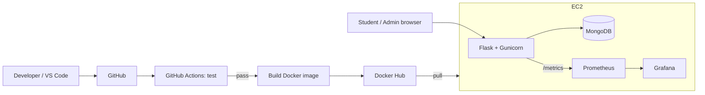

# Student Feedback Management System with CI/CD

## Run locally
    pip install -r requirements.txt && pytest
    docker compose up --build      # app :5000, Prometheus :9090, Grafana :3000
Logins: admin / admin123 (at /admin/login) · students 24CSE101–24CSE105 / student123

## Architecture

Set GitHub secrets: DOCKERHUB_USERNAME, DOCKERHUB_TOKEN, EC2_HOST, EC2_KEY. Kubernetes is optional and not included.
